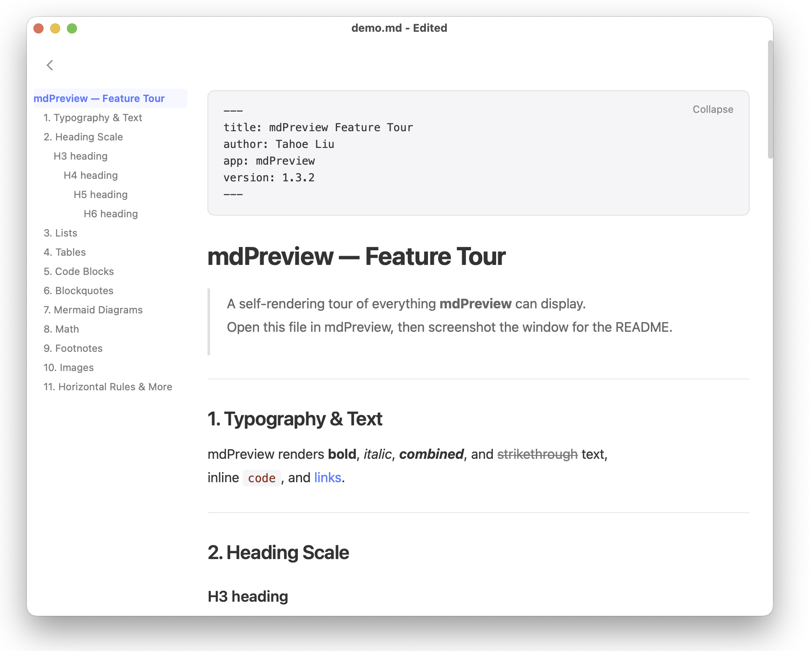
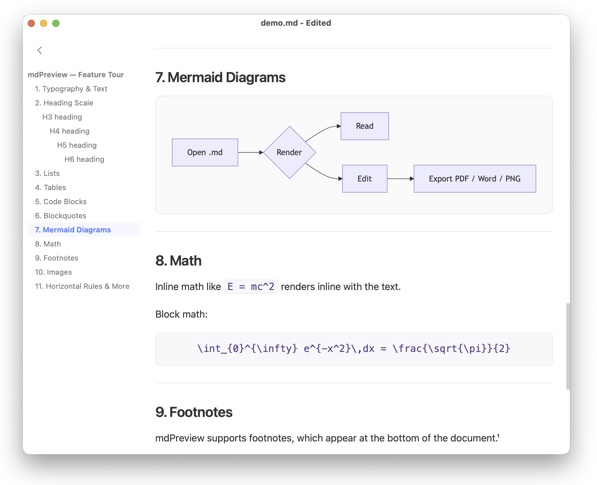

# mdPreview — A Minimal Markdown Viewer & Editor for macOS

[简体中文](README.zh-CN.md) · [Changelog](CHANGELOG.md) · [Contributing](CONTRIBUTING.md) · [Security](SECURITY.md)

<div align="center">

**Open, read, edit and share Markdown files on Mac — in a clean, distraction-free window.**

[Download for macOS](https://github.com/tahoeliu/mdPreview/releases/latest) · Free · Open source (MIT) · Works offline

</div>

<p align="center">
  
  &nbsp;
  
</p>

---

## Why mdPreview?

Markdown files are everywhere: AI chat exports, README files, meeting notes, research notes, personal knowledge bases. But opening a `.md` file still feels technical.

**Double-click a Markdown file and read it like a normal document** — no browser, no account, no heavy editor. When you need to share it, export a properly typeset PDF or Word file, or copy it as rich text into Mail, Notes, Word or a chat app.

| You want to… | mdPreview |
|---|---|
| Read AI-generated answers (ChatGPT, Claude, Gemini…) | Renders tables, code, math, Mermaid diagrams and footnotes correctly |
| Read a long document | Outline sidebar, remembers where you stopped, reloads when the file changes |
| Hand it to someone who doesn't use Markdown | PDF, Word, HTML, PNG, plain text — or **Copy as Rich Text** |
| Print it | Compact 10.5 pt typography, real pagination, page numbers |
| Fix a typo or two | Switch to source mode (`⌘E`) or edit the preview directly |
| Keep things private | No account, no telemetry, no cloud, works offline |

## Install

**Option A — one line, no security prompt (recommended).** Open Terminal and run:

```bash
curl -fsSL https://raw.githubusercontent.com/tahoeliu/mdPreview/main/scripts/get.sh | bash
```

The script is short and worth reading first. It downloads the latest release for your Mac (Apple Silicon or Intel), verifies an ECDSA signature over the checksum list and the archive checksum, checks the app's identity, and installs it into `/Applications`. Files fetched with `curl` are not quarantined by macOS, so no Gatekeeper dialog appears. It never uses `sudo` and never touches quarantine attributes.

**Option B — Homebrew:**

```bash
brew install --cask --no-quarantine tahoeliu/tap/mdpreview
```

**Option C — disk image:** download `mdPreview-<version>-arm64.dmg` (Apple Silicon) or `-x86_64.dmg` (Intel) from [Releases](https://github.com/tahoeliu/mdPreview/releases/latest) and drag the app into Applications.

> **Why does macOS warn me about the disk image?** mdPreview is free open-source software signed with an *ad-hoc* signature rather than a paid Apple Developer certificate, so it is not notarized. A browser-downloaded copy is therefore blocked on first launch. Open **System Settings → Privacy & Security** and click **Open Anyway** next to mdPreview (macOS 15 and later; on 13–14 you can also Control-click → Open). You only need to do this once. Options A and B avoid the prompt.

The release signing key fingerprint (SHA-256 of the public key) is published in [SECURITY.md](SECURITY.md).

Requires macOS 13 or later. Apple Silicon builds are verified by the maintainer; Intel builds are produced and smoke-tested by CI on an Intel runner.

### Make it the default for `.md` files

Select any `.md` file in Finder → **File → Get Info → Open with → mdPreview → Change All…**

## What it can do

### Reading
- Outline sidebar, dark mode, adjustable text size (`⌘=` / `⌘-`, reset `⌘0`) and reading width (`⌥⌘=` / `⌥⌘-`)
- Remembers your window position, text size and reading position per document
- Reloads automatically when another program (or an AI agent) changes the file
- **Made for long AI answers:** reading-time left and progress (only in long documents), **fold any section**, long code blocks and tables fold to a head, **Go to Heading** (`⌘J`), **New from Clipboard** (`⌥⌘N`)
- Find (`⌘F`), multiple windows, open linked `.md` files with a click, drag a `.md` file onto the window
- Tables, task lists (click to tick), footnotes, front matter, syntax-highlighted code with a copy button
- **Math** with KaTeX (`$…$`, `$$…$$`, `\(…\)`, `\[…\]`), **Mermaid** diagrams, GitHub-style alerts (`> [!NOTE]`)
- Chinese typography done properly (language-aware fonts, spacing)

### Editing
- Click into the rendered page and a slim formatting bar appears at the top — bold, headings, lists, links, tables (add/remove rows and columns) — so no Markdown syntax is needed. `Esc` returns to reading; *View → Always Show Formatting Bar* (`⌥⌘T`) pins it. Or switch to source (`⌘E`) with `⌘B` / `⌘I` / `⌘K`, list continuation and Tab indenting
- **Paste as Markdown** (`⇧⌘V`): paste formatted text from web pages, docs and AI chats and get clean Markdown
- Paste or drop images: they are saved next to the document in `assets/` and linked with relative paths
- Drafts are autosaved; saving never overwrites changes you made while the disk write was pending

### Sharing
Export with **File → Export As…** or print with `⌘P`:

| Format | Notes |
|---|---|
| **PDF** | Real pagination on A4 or Letter, compact 10.5 pt body independent of on-screen zoom, page numbers, bookmarks from headings, searchable and copyable Chinese text, links kept |
| **Word (.docx)** | Native Word document: real Heading styles, tables with repeating header rows, images, footnotes; formulas and diagrams as images |
| **HTML** | A shareable single page: images embedded, outline sidebar on wide screens, reading time, dark mode, print styles |
| **PNG** | One long, light-themed image |
| **Plain text / Markdown** | Real plain text (no `##` or `**`), or the Markdown source |
| **Copy as Rich Text** (`⇧⌘C`) | Puts HTML, RTF and plain text on the clipboard, so headings, tables and code keep their formatting when pasted into apps such as Mail, Notes, Word or chat tools |

Export options (paper, margins, font size, page numbers, front matter…) are in **Settings** (`⌘,`) and remembered.

### Command line
**mdPreview → Install Command Line Tool…** adds `mdpreview`:

```bash
mdpreview notes.md                                  # open in the app
mdpreview export notes.md --to pdf -o notes.pdf     # headless export: pdf, html, docx, txt, png
```

## Keyboard shortcuts

| Shortcut | Action | Shortcut | Action |
|---|---|---|---|
| `⌘N` | New | `⌘F` / `⌘G` / `⇧⌘G` | Find / next / previous |
| `⌘O` | Open | `⌘=` / `⌘-` / `⌘0` | Bigger / smaller / reset text |
| `⌘S` / `⇧⌘S` | Save / Save As | `⌥⌘=` / `⌥⌘-` / `⌥⌘0` | Wider / narrower / reset width |
| `⌘P` | Print | `⌥⌘O` | Show / hide outline |
| `⌘E` | Preview ⇄ Source | `⌃⌘F` | Full screen |
| `⇧⌘V` | Paste as Markdown | `⇧⌘C` / `⌥⌘C` | Copy as Rich Text / as Markdown |
| `⌘,` | Settings | `⌘I` | Properties |
| `⌘J` | Go to Heading | `⌥⌘N` | New from Clipboard |

The Help menu has the full list, a sample document, **Report an Issue…** (pre-fills only version and OS) and **Export Diagnostics…**.

## Privacy

- No account, no ads, no telemetry, no cloud sync, no document upload.
- **Remote images are not loaded by default** — a bar offers *Load* / *Always load*, because loading an image tells its server that you opened the file. Mermaid, math and everything else render locally.
- The only network access is an optional **update check**: one request to GitHub's releases API, on by default, switch it off in Settings. Updates are verified against the release signing key before anything is installed.
- Diagnostic archives contain allow-listed settings and structured events only — never document text or paths. Inspect them before sharing.

## Safety

Markdown can contain HTML. All rendered content goes through DOMPurify with URL filtering, and the page runs under a strict Content-Security-Policy (no inline scripts, no `eval`). Third-party libraries are vendored, checksummed and listed with their licenses in [THIRD_PARTY_NOTICES.md](THIRD_PARTY_NOTICES.md).

## FAQ

**Do I need to know Markdown?** No. Use it as a reader; switch to source only when you want to.

**Is it really free?** Yes, MIT-licensed. If it saves you time, a GitHub star helps others find it.

**Does it work offline?** Yes. Nothing is needed from the network except the optional update check.

**Does it support Finder's spacebar preview (Quick Look)?** Yes — the extension is bundled and registered on first launch. If macOS does not show it, enable *mdPreview Quick Look* in System Settings → General → Login Items & Extensions → Quick Look. See [`quicklook/`](quicklook/README.md) for what is verified.

**Is it a replacement for Typora / VS Code?** No — it is a focused reader with convenient editing and best-in-class sharing, not a writing studio or an IDE.

## Build from source

```bash
python3.13 -m venv .venv
.venv/bin/python -m pip install -r requirements-lock.txt
npm ci --ignore-scripts && npm run vendor
npm test && .venv/bin/python scripts/test-python.py
./build.sh            # → WorkSpace/dist/release-<version>/mdPreview.app
```

See [CONTRIBUTING.md](CONTRIBUTING.md) for the project layout and rules, and [RELEASE.md](RELEASE.md) for how releases are cut and verified.

## License

MIT — see [LICENSE](LICENSE). Made by [Tahoe Liu](https://github.com/tahoeliu).

---

**Keywords:** macOS Markdown viewer, Markdown reader for Mac, open .md files on Mac, Markdown to PDF, Markdown to Word, AI Markdown viewer, ChatGPT Markdown, Claude Markdown export, Typora alternative, MacDown alternative, open source Markdown viewer, Mermaid, KaTeX
